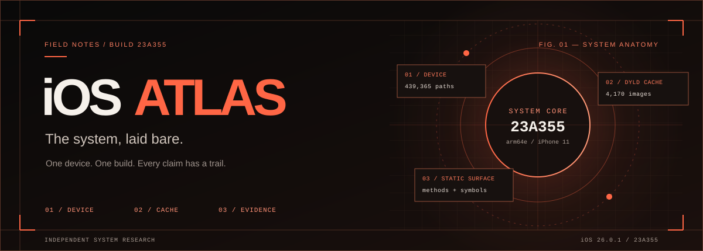
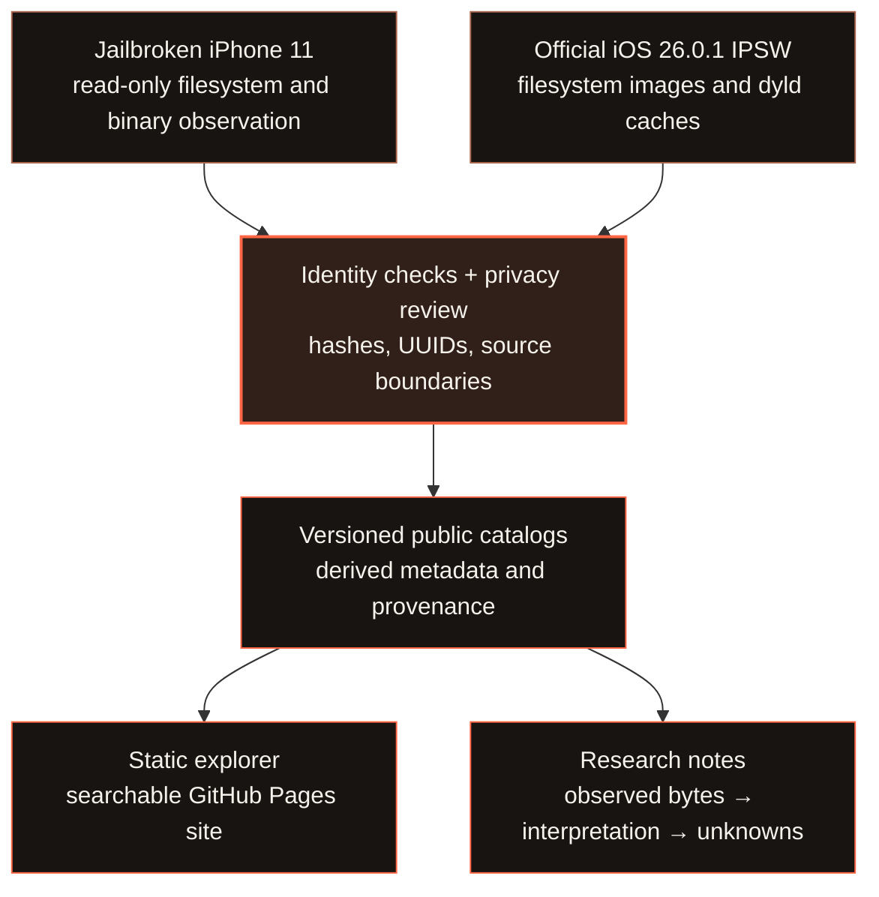

# iOS Atlas



**A searchable, evidence-backed map of iOS internals from one jailbroken iPhone.** Start with files observed on the device, follow libraries into the dyld shared cache, and inspect build-specific static metadata and research notes.

[**Explore the live atlas ↗**](https://xnu.app/ios-atlas/) · [Browse research notes](https://xnu.app/ios-atlas/#research) · [See coverage](https://xnu.app/ios-atlas/#coverage) · [Read the delivery summary](docs/handoff-23A355.md)

> [!NOTE]
> The first release describes **iPhone 11 (`iPhone12,1`) on iOS 26.0.1 (`23A355`)**. It maps one observed device and its matching official firmware. Each view states its source and coverage; the public site does not claim unrestricted access to every device file or observed runtime behavior.

## At a glance

| Observed device | Exact-build firmware | Static code surface |
| :--- | :--- | :--- |
| **439,365** privacy-reviewed paths | **4,170** iOS dyld cache images | **3,065,801** indexed Objective-C method entries |
| **3,622** verified public Mach-O file paths | **3,363** standalone Mach-O files | **6,585,655** named iOS cache `__text` symbols |
| **10 / 12** filesystem views complete | **51** separate DriverKit cache images | **621** stock launchd service plists |

These numbers describe different layers and should not be added together. See the [detailed catalog coverage](docs/catalog-coverage-23A355.md) for definitions, exclusions, and source notes.

## Explore a layer

| Start here | What you can inspect |
| :--- | :--- |
| [**On-device files**](https://xnu.app/ios-atlas/#device) | Browse the published live paths folder by folder; search paths and reviewed content-format labels. |
| [**Shared-cache images**](https://xnu.app/ios-atlas/#images) | Find logical library install names, brief introductions, direct loads, symbols, and method counts. |
| [**Objective-C methods**](https://xnu.app/ios-atlas/#methods) | Search classes, categories, selectors, and implementation addresses within an exact cached image. |
| [**Dependency reach**](https://xnu.app/ios-atlas/#reach) | Trace shortest static library-declaration chains, with weak loads included or excluded. |
| [**System services**](https://xnu.app/ios-atlas/#services) | Follow launchd declarations to executables and their direct library loads. |
| [**Research**](https://xnu.app/ios-atlas/#research) | Read focused notes linked back to exact files, cache images, UUIDs, and inspection commands. |

The explorer also includes [firmware files](https://xnu.app/ios-atlas/#files), [Jailbreak Mach-O](https://xnu.app/ios-atlas/#device_macho), [Developer Mach-O](https://xnu.app/ios-atlas/#developer_macho), [Swift conformances](https://xnu.app/ios-atlas/#swift), [kernel metadata](https://xnu.app/ios-atlas/#kernel), and [coverage](https://xnu.app/ios-atlas/#coverage).

## How the atlas is built



The [Foundation example](research/23A355/Foundation.md) shows why both sources matter: its framework **directory** appears in the stock filesystem, while the executable **image** lives in the dyld shared cache. The Atlas links the two without inventing a separate on-disk executable. Library loads, method names, and symbols are static evidence; they do not by themselves show what ran in a process.

## Research starting points

- **SpringBoard startup:** [launch declaration and entry point](research/23A355/SpringBoard.md) → [startup function](research/23A355/SpringBoard-Startup.md) → [UIKit application entry](research/23A355/UIKitCore-ApplicationMain.md).
- **Event loop:** [UIKitCore `_run`](research/23A355/UIKitCore-RunLoop.md) → [GraphicsServices event runner](research/23A355/GraphicsServices-Event-Run.md) → [CoreFoundation run-loop wrappers](research/23A355/CoreFoundation-RunLoop.md).
- **Method coverage:** [Foundation](research/23A355/Foundation-Method-Surface.md), [SpringBoard](research/23A355/SpringBoard-Method-Surface.md), and the [all-image catalog](research/23A355/Method-Catalog-Coverage.md).

Focused implementation and runtime studies continue [on demand](docs/research-todo.md). An image marked **Awaiting analysis** still has its indexed static metadata.

## Scope and reproducibility

The public live-path catalog covers 10 complete filesystem views and two partial data-volume views. **73 protected directories** remained inaccessible to read-only metadata inspection, so their descendants are unknown. User and app path names, private binaries, and a device-specific randomized filename remain outside the public catalog. See the [collection procedure](docs/live-device-collection.md), [acquisition record](docs/acquisition-23A355.md), and [coverage detail](docs/catalog-coverage-23A355.md).

Raw IPSW files, dyld caches, extracted Apple binaries, and private device data stay outside Git. This repository contains derived indexes, provenance, tools, and original research. The official IPSW is a distribution source for this exact build; the project does not present a clean-system versus jailbreak comparison.

| Directory | Purpose |
| :--- | :--- |
| [`catalog/`](catalog/) | Versioned machine-readable indexes and coverage reports. |
| [`research/`](research/) | Source-bound component and behavior notes. |
| [`tools/`](tools/) | Read-only collection, validation, and site-generation scripts. |
| [`site/`](site/) | The static explorer's HTML, CSS, and JavaScript. |
| [`docs/`](docs/) | Acquisition, coverage, delivery, and research plans. |

### Build locally

```sh
python3 tools/build_site.py
python3 -m http.server 8000 --directory dist
```

Open <http://localhost:8000/>. The [Pages workflow](.github/workflows/pages.yml) runs the same build, checks the public exports, and publishes the site at <https://xnu.app/ios-atlas/>.
